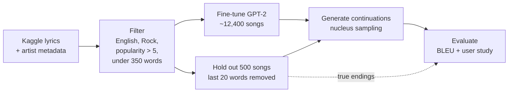

<h1 align="center">Finish the Lyric</h1>

  <b>Fine-tuning GPT-2 to continue rock song lyrics</b> 
  CS412 Information Retrieval · GIK Institute of Engineering Sciences &amp; Technology · 2023

  
  
  

  <a href="docs/Project-Report.pdf"><b>📄 Project report</b></a>

---

> [!NOTE]
> This is a coursework project from my undergraduate studies (BS Computer Science, GIKI). I'm posting it to GitHub retroactively, for the record.
>
> This repository documents the approach and results. The source code is not included.

## Overview

Given the opening of a rock song, the model writes what comes next. GPT-2 is fine-tuned on thousands of English rock lyrics so its continuations pick up the genre's vocabulary, themes and line lengths. Output is scored against the real endings of songs the model never saw.

## Pipeline

1. **Data.** The *Song lyrics from 6 musical genres* dataset on Kaggle (scraped from vagalume.com.br) is joined with its artist table. Then it is filtered down to English songs by popular rock artists (popularity > 5). Songs over 350 words are dropped so they fit GPT-2's context window.
2. **Test set.** 500 songs are held out. The last 20 words of each are cut off and kept as the reference ending.
3. **Fine-tuning.** Each song is tokenized with GPT-2's tokenizer and closed with an end-of-text token. Songs are packed into sequences of up to 768 tokens, and the model is trained as a causal language model.
4. **Generation.** The model continues each held-out song from where it was cut, using nucleus (top-p) sampling. The output is trimmed at the last full stop so it ends on a complete line.
5. **Evaluation.** Continuations are compared with the real endings using BLEU. BLEU only measures word overlap, not whether a line fits, so the team also ran an informal user study. People fed in lyric fragments of their own and judged the continuations.

## Training setup

| Setting | Value |
| --- | --- |
| Base model | GPT-2 small (124M parameters), Hugging Face `gpt2` |
| Optimizer | AdamW, learning rate 2e-5 |
| Schedule | Linear, 200 warm-up steps |
| Effective batch | 16 packed sequences (gradient accumulation) |
| Max sequence length | 768 tokens |
| Training data | ~12,400 songs |
| Run | 4 epochs, about 33 minutes each on a single GPU |
| Decoding | top-p 0.8, temperature 1.0, up to 30 new tokens |

## Results

In the user study, the fine-tuned model's continuations were **coherent, stayed on the song's theme and matched the expected line length**. BLEU scores and sample outputs are in the [project report](docs/Project-Report.pdf).

**Next steps** the team identified include adding constraints such as rhyme, and applying the same fine-tuning approach to other text-generation tasks.

## Team

**Asad Shahab** · Shams Ghani · M. Salman Manzoor

Instructor: Dr. Khurram Jadoon

## References

1. A. Radford, J. Wu, R. Child, D. Luan, D. Amodei, I. Sutskever. *Language Models are Unsupervised Multitask Learners* (GPT-2). OpenAI, 2019. [PDF](https://cdn.openai.com/better-language-models/language_models_are_unsupervised_multitask_learners.pdf)
2. *Song lyrics from 6 musical genres.* Kaggle. [Dataset](https://www.kaggle.com/datasets/neisse/scrapped-lyrics-from-6-genres)
3. Hugging Face *Transformers*. [GitHub](https://github.com/huggingface/transformers)
