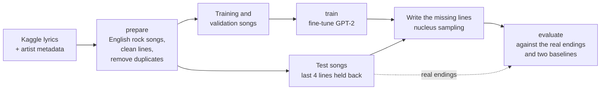

<h1 align="center">Finish the Lyric</h1>

<p align="center">
  <b>Fine-tuning GPT-2 to continue rock song lyrics</b><br>
  CS412 Information Retrieval · GIK Institute of Engineering Sciences &amp; Technology · 2023
</p>

<p align="center">
  
  
  
  
</p>

<p align="center">
  <a href="docs/Project-Report.pdf"><b>📄 Project report</b></a> ·
  <a href="finish_the_lyric">Code</a>
</p>

---

> [!NOTE]
> This is a coursework project from my undergraduate studies (BS Computer Science, GIKI). I'm posting it to GitHub retroactively, for the record.
>
> The code is a clean rewrite of the project. No trained model is included: you can train one with the steps below. The results at the end are from the original study.

## Overview

Given the opening of a rock song, the model writes the next few lines. GPT-2 is fine-tuned on thousands of English rock lyrics so that its lines pick up the genre's vocabulary, themes and line lengths. Its endings are compared with the real endings of songs it never saw, and with two baselines.

## How it works



1. **Data.** The *Song lyrics from 6 musical genres* dataset on Kaggle (scraped from vagalume.com.br) is joined with its artist table. It keeps English songs by artists whose main genre is a kind of rock (Rock, Hard Rock, Pop/Rock, Punk Rock and so on) and whose popularity score is above 5.
2. **Cleaning.** Each song is split into lines. Section labels such as `[Chorus]` and repeat markers such as `(x2)` are removed. Songs with fewer than 8 lines or more than 500 words are dropped.
3. **Duplicates.** Live versions, re-releases and covers are removed: songs with the same lyrics, or with the same title from the same artist once notes like "(Live)" are stripped. This way no test song has a copy in the training data.
4. **Splits.** 500 songs are set aside for testing and 5% of the rest for validation. The remainder is used for training.
5. **Fine-tuning.** The training songs are joined into one stream, each followed by an end-of-text token, and cut into 512-token blocks. GPT-2 learns to predict each next token. The validation loss is checked after every epoch, the best model is kept, and training stops early once the loss stops improving.
6. **Generation.** The model reads the song so far (up to its last 384 tokens) and writes with nucleus sampling until it has finished the requested number of whole lines.

## Evaluation

The last four lines of each test song are held back, and three systems write them:

- **Fine-tuned GPT-2**: the trained model.
- **GPT-2, not fine-tuned**: the starting model, to show what fine-tuning adds.
- **Repeat last lines**: copies the four lines before the gap. Songs often end on a repeated chorus, so this simple baseline can score well on word overlap.

| Measure | What it shows |
| --- | --- |
| BLEU | Overlap of word sequences with the real ending ([sacreBLEU](https://github.com/mjpost/sacrebleu), corpus level) |
| chrF | Overlap of character sequences, which gives partial credit for close words |
| Ending perplexity | How expected the real ending was to the model, given the lines before it. Lower is better. |
| distinct-2 | Variety: the share of word pairs across all outputs that are unique |
| Copied lines | The share of lines repeated from earlier in the song, compared with how often the real endings repeat |
| Words per line | Whether the lines have the right length |

A song can end in many good ways, so BLEU and chrF are low for creative text and are most useful for comparing systems. Ending perplexity doesn't depend on sampling, which makes it the most direct test of whether fine-tuning taught the model how rock songs go. The BLEU score in the original report (0.685) was computed on characters rather than words, so it isn't comparable with these scores.

`evaluate` writes the scores to `metrics.md` and `metrics.json`, and every system's output for every test song to `samples.csv`.

## Running it

Requires Python 3.10 or later. A GPU is strongly recommended for training.

```bash
pip install -r requirements.txt
```

Download `artists-data.csv` and `lyrics-data.csv` from the [Kaggle dataset](https://www.kaggle.com/datasets/neisse/scrapped-lyrics-from-6-genres) into `data/raw/`. Then:

```bash
python -m finish_the_lyric.prepare                                  # data/raw → data/processed
python -m finish_the_lyric.train                                    # fine-tune → models/finish-the-lyric
python -m finish_the_lyric.evaluate --model models/finish-the-lyric # → outputs/evaluation
python -m finish_the_lyric.generate "Out on the highway / The engine's running hot / Nothing in the mirror"
```

Every command takes `--help`. Without a GPU, `train --max-train-songs 500 --epochs 1` gives a quick run to check everything works. The unit tests run with `pytest`.

**Default settings**

| Setting | Value |
| --- | --- |
| Base model | GPT-2 small (124M parameters), Hugging Face `gpt2` |
| Training blocks | 512 tokens |
| Batch | 8 blocks, 4 batches per optimizer step |
| Optimizer | AdamW, learning rate 5e-5, weight decay 0.01 |
| Schedule | 6% warm-up, then linear decay |
| Epochs | Up to 3, stopping early if the validation loss stops improving |
| Precision | bfloat16 or float16 on a GPU |
| Generation | 4 lines; top-p 0.9, temperature 0.9, repetition penalty 1.1 |

## Original study

The coursework version fine-tuned GPT-2 on about 12,400 songs for 4 epochs, about 33 minutes each on a single GPU, and held back the last 20 words of 500 test songs. In a user study, its continuations were **coherent, stayed on the song's theme and matched the expected line length**. Sample outputs are in the [project report](docs/Project-Report.pdf).

**Next steps** the team identified include adding constraints such as rhyme, and applying the same fine-tuning approach to other text-generation tasks.

## Team

**Asad Shahab** · Shams Ghani · M. Salman Manzoor

Instructor: Dr. Khurram Jadoon

## References

1. A. Radford, J. Wu, R. Child, D. Luan, D. Amodei, I. Sutskever. *Language Models are Unsupervised Multitask Learners* (GPT-2). OpenAI, 2019. [PDF](https://cdn.openai.com/better-language-models/language_models_are_unsupervised_multitask_learners.pdf)
2. *Song lyrics from 6 musical genres.* Kaggle. [Dataset](https://www.kaggle.com/datasets/neisse/scrapped-lyrics-from-6-genres)
3. Hugging Face *Transformers*. [GitHub](https://github.com/huggingface/transformers)
4. M. Post. *A Call for Clarity in Reporting BLEU Scores.* WMT 2018. [arXiv](https://arxiv.org/abs/1804.08771)
5. M. Popović. *chrF: character n-gram F-score for automatic MT evaluation.* WMT 2015. [ACL Anthology](https://aclanthology.org/W15-3049/)
6. A. Holtzman, J. Buys, L. Du, M. Forbes, Y. Choi. *The Curious Case of Neural Text Degeneration* (nucleus sampling). ICLR 2020. [arXiv](https://arxiv.org/abs/1904.09751)
